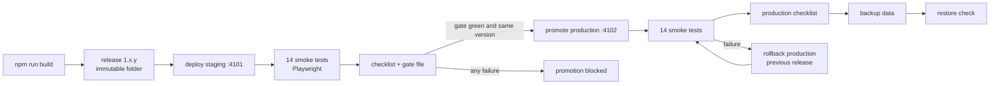
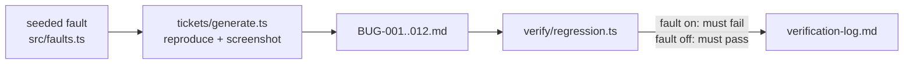

# release-smoke-test-lab

[](https://github.com/hamza2829/release-smoke-test-lab/actions/workflows/ci.yml)

Maintenance and testing kit for a simulated education platform called **LernWerk**
(a small Node.js/TypeScript web app with a learning content editor, login and search).
Two local instances, **staging** (port 4101) and **production** (port 4102), receive versioned
releases. Every deployment is followed by Playwright smoke tests and a rendered release checklist;
promotion to production is blocked unless staging passed; rollback and backup/restore are scripted
and exercised on every CI run. Bug reports are generated from seeded faults with Playwright
screenshots, and a regression script re-tests every ticket.

## Release flow





## Layout

| Folder | Content |
|---|---|
| `src/` | The simulated platform: plain `node:http` server, JSON file store, scrypt login with sessions, ranked search with umlaut handling, HTML views, 12 switchable seeded faults |
| `envs/` | Release manager (`release`, `deploy`, `promote`, `rollback`, `backup`, `restore`, `status`, `stop`), pure state logic in `state.ts`, full flow in `pipeline.sh` |
| `smoke/` | 14 Playwright smoke tests (`SMK-01`..`SMK-14`) run after every deployment: health and version, login, logout, content, 404, search, edit and save, validation |
| `checklists/` | Markdown release checklist (14 items mapped to smoke tests) and a runner that renders it as Markdown and HTML with pass/fail, tester, date and build, plus the promotion gate file |
| `testcases/` | 40 documented test cases in YAML (ID, area, priority, preconditions, steps, expected result, automation link) and a validator that also checks every `SMK-xx` reference exists |
| `tickets/` | Bug report template, catalogue of 12 tickets tied to seeded faults, generator, and the 12 generated sample reports with Playwright screenshots in `tickets/reports/` |
| `verify/` | Regression script: each ticket is re-tested with the fault on (must be detected) and on the fixed build (must pass), result written to `reports/verification-log.md` |
| `docs/` | Run book and step by step guides: [update](docs/update.md), [rollback](docs/rollback.md), [dependency update](docs/dependency-update.md), [backup and restore](docs/backup-restore.md), [run book](docs/runbook.md) |
| `tests/` | 51 Vitest unit and HTTP tests |

## Run it

```bash
npm ci
npx playwright install chromium
npm run typecheck && npm run build
npm test                       # 51 Vitest tests
npm run testcases:validate     # 40 test cases
npm run pipeline               # release 1.0.0 and 1.1.0, staging -> smoke -> promote -> smoke, rollback, restore
npm run tickets                # 12 bug reports with screenshots
npm run verify                 # regression verification log
```

Demo accounts of the simulated platform: `editor` / `editor-pass`, `viewer` / `viewer-pass`.

## Results

All numbers below were measured, not estimated. "Local" is a 2 vCPU Linux container,
"CI" is GitHub Actions `ubuntu-latest`, run [45382012658](https://github.com/hamza2829/release-smoke-test-lab/actions/runs/45382012658).
The fresh clone column is a new `git clone` into an empty directory followed by the same commands.

| Measure | Local | Fresh clone | CI |
|---|---|---|---|
| Vitest tests passed | 51 / 51 (3.6 s) | 51 / 51 (4.5 s) | step green |
| Test cases validated | 40 (18 smoke, 16 unit, 6 manual) | 40 | 40 |
| Smoke test runs in the release flow | 5 runs × 14 = 70 / 70 passed | 70 / 70 | 70 / 70 |
| Duration of one smoke run (14 tests) | 5.4 to 6.7 s | 5.4 to 7.1 s | 4.4 to 4.9 s |
| Deploy time (stop old, start release, health shows new version) | 203 to 367 ms | 359 to 377 ms | 206 to 363 ms |
| Rollback production 1.1.0 → 1.0.0 | 378 ms | 361 ms | 366 ms |
| Restore check (page revision at backup / after change / after restore) | 4 / 5 / 4 | 4 / 5 / 4 | 4 / 5 / 4 |
| Full `npm run pipeline` | 41.0 s | 46.3 s | 36 s (step time) |
| Seeded faults reproduced by the ticket generator | 12 / 12 | 12 / 12 | 12 / 12 |
| Tickets verified (detected with fault, pass when fixed) | 12 / 12 in 10.0 s | 12 / 12 in 11.3 s | 12 / 12 in 7.6 s |
| Whole CI job | | | 81 s |

CI uploads the artifact `release-reports` with five checklist reports (Markdown and HTML),
the Playwright JSON reports, smoke test screenshots, the 12 regenerated tickets with screenshots,
the verification log, the deploy history and the app logs of both instances.

## Seeded faults and tickets

| Ticket | Fault | What breaks |
|---|---|---|
| BUG-001 | `search-case-sensitive` | "FRACTIONS" finds nothing |
| BUG-002 | `search-empty-500` | Empty search returns HTTP 500 |
| BUG-003 | `search-single-result` | Only the first match is shown |
| BUG-004 | `search-umlaut` | "ubungen" does not find "Übungen" |
| BUG-005 | `save-drops-body` | Edited text is lost on save |
| BUG-006 | `save-title-unescaped` | HTML in a title is rendered |
| BUG-007 | `save-empty-title` | Empty title can be saved |
| BUG-008 | `login-any-password` | Any password is accepted |
| BUG-009 | `logout-keeps-session` | Old session works after logout |
| BUG-010 | `health-wrong-version` | Health reports 0.0.0 |
| BUG-011 | `content-missing-500` | Unknown content gives HTTP 500 instead of 404 |
| BUG-012 | `list-unsorted` | Content list is not sorted |

Faults are off by default and switched on with `FAULTS=<id>,<id>`. Sample reports: [tickets/reports](tickets/reports/README.md).

## Honest section

- The platform is simulated. LernWerk is a small app written for this lab, with 8 seeded learning units and two demo accounts. It is not a real education product.
- "Staging" and "production" are two local Node.js processes on ports 4101 and 4102 on the same machine (or CI runner). There is no real hosting, no load balancer, no TLS, no database server; data is a JSON file per environment.
- Version 1.1.0 in the pipeline is the same code as 1.0.0 with a different version label. It exists to exercise promotion and rollback, not to ship a feature.
- The 12 bugs are deliberately seeded faults, not bugs found in production. The "fix" in the verification step means switching the fault off.
- Smoke test durations are small because the app is small and local; they say nothing about the performance of a real platform.
- Test cases marked `manual` (6 of 40) are documented but not automated.
